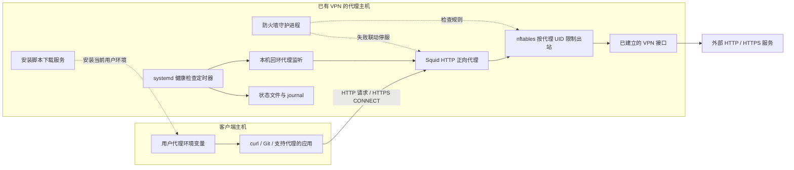

# VPN HTTP 代理

本项目将一台已有 VPN 连接的 Linux 主机作为 HTTP 正向代理出口，让其他机器上的 curl、Git 等应用通过这台主机访问外网。项目负责代理部署、客户端环境配置、VPN 出口限制和健康检查；VPN 连接由主机原有的 VPN 客户端维护。

访问权限由服务端配置的来源地址白名单决定，默认只显式授权已知的编译服务器。支持 Linux Bash 和 Windows PowerShell 客户端，每个用户独立安装自己的代理环境。

## 架构



当前仓库配置的监听如下，均由 `config.json` 生成或读取：

| 用途 | 当前地址 | 访问方式 |
| --- | --- | --- |
| 应用代理 | `172.16.14.233:7897` | 通过来源 CIDR 白名单控制 |
| 本机健康检查 | `127.0.0.1:17897` | 仅回环监听 |
| Linux 安装脚本 | `172.16.14.233:8089/install.sh` | 与代理共用来源网段配置 |
| Windows 安装脚本 | `172.16.14.233:8089/install.ps1` | 与 Linux 下载共用访问策略 |
| 外网出口 | `ppp0` | 依赖主机已建立的 VPN 和路由 |

这些是当前部署参数，客户端和服务端程序不校验某一台固定的客户端机器。

## 工作原理

### 应用如何使用代理

客户端安装器写入 `http_proxy`、`https_proxy` 及对应的大写变量，并清除 `all_proxy` / `ALL_PROXY`。支持这些变量的应用随后连接 Squid。

HTTP 请求由 Squid 转发。HTTPS 请求先向 Squid 发送 CONNECT，建立到目标 443 端口的 TCP 隧道，再由客户端与目标站点进行 TLS 握手。项目没有配置 TLS 解密或证书替换，因此 `https_proxy` 仍使用 `http://代理地址:端口`。

`no_proxy` 用于让指定地址绕过代理。安装器保留用户已有条目，加入本机回环地址、所选代理主机，以及配置或参数指定的条目。默认条目中的 RFC1918 CIDR 依赖较新的工具：curl 7.86.0 之前不支持 NO_PROXY 中的 CIDR 写法，旧客户端需把实际内网服务的主机名或 IP 显式加入 `no_proxy`，详见[操作说明](docs/operations.md)。

此方式只影响使用该代理的应用。脚本不修改客户端默认路由，也不部署系统级流量转发或 NAT；已运行的子进程、其他用户及独立 systemd 任务不会自动继承当前用户的新环境。

### 代理访问控制与 DNS

Squid 只允许 `allowed_clients` 中的来源网段，以及本机回环健康检查。目标端口限于 80、443，CONNECT 仅允许 443；访问回环、私网、链路本地等配置列出的目标地址会被拒绝。

Squid 直接向 `dns_nameservers` 指定的 DNS 服务器查询。DNS 请求由代理进程发出，也受 VPN 出口规则约束，不通过主机的本地 DNS stub 转发。

代码关闭磁盘缓存，保留访问和运行日志。

### VPN 断线保护

Squid 以独立系统用户 `rk-vpn-proxy` 运行。[scripts/firewall.sh](scripts/firewall.sh) 创建专用 `inet rk_vpn_proxy` 表，只匹配这个用户的出站流量，依次放行：

1. 从代理监听端口返回客户端的连接回复。
2. Squid 在回环接口上的本机 UDP 进程通信。
3. 经 `vpn_interface` 指定接口发出的流量，包括 DNS。

其余出站流量被拒绝。即在专用 nftables 规则保持生效的情况下，阻止代理经非 VPN 接口出站；规则异常由守护进程检测并触发代理停止。普通 VPN 掉线由内核中的规则直接阻断，即使系统改用普通网卡，代理也不能借用该出口；VPN 接口及正确路由恢复后，新请求可恢复，已经断开的下载仍需客户端重试。

`rk-vpn-proxy-firewall.service` 原子加载规则，确认就绪后才允许代理启动，并每秒对比专用表的完整规则（忽略计数值）。规则缺失或变化时守护进程失败退出，`BindsTo` 联动停止代理；守护进程意外退出也会触发停服。代理每次启动还会复查规则。停止服务保留现有规则，排查后需手动重启防火墙和代理。

### 配置生成与健康检查

[configuration.py](configuration.py) 校验配置，[build-installer.py](build-installer.py) 生成独立客户端安装脚本、Squid 配置及运行参数文件。生成文件位于 `build/`。部署后的配置位于 `/etc/rk-vpn-proxy/`，下载程序及脚本副本位于 `/usr/local/lib/rk-vpn-proxy/`，下载服务从已部署配置读取访问白名单。

健康检查由 `rk-vpn-health` 用户运行，定时器开机约 45 秒后首次触发，此后约每 60 秒执行一次。它分别记录 `VPN_UP`、`VPN_ROUTE_OK`、`PROXY_REACHABLE`、`FIREWALL_ENFORCED`，检查接口地址、DNS 路由、守护进程最近 3 秒内的规则检查结果及回环代理的 HTTPS 出口。防火墙失效时跳过公网请求。

检查失败返回非零退出码；状态变化和出口 IP 变化写入 journal。状态文件保存在 `/var/lib/rk-vpn-proxy/status` 和 `/var/lib/rk-vpn-proxy/exit-ip`。健康检查负责探测和记录，不控制 VPN 重连。

## 优点与限制

| 优点 | 对应实现 |
| --- | --- |
| 适用于多台客户端、多个用户 | 客户端安装按当前 `HOME` 写入，权限按服务端 CIDR 控制 |
| 应用接入方便 | 使用常见 HTTP 代理环境变量，支持 HTTPS CONNECT |
| 出口限制范围明确 | nftables 只对 `rk-vpn-proxy` 用户增加出站限制 |
| VPN 中断时阻止普通网络回退 | 按实际出站接口放行，其他出口拒绝 |
| 部署参数集中管理 | 配置校验后生成代理、客户端和防火墙运行参数 |
| 可运维和验证 | systemd 服务、日志轮转、状态探测、配置备份与隔离网络测试 |

实际使用中需要考虑以下限制：

- 支持范围是 HTTP/HTTPS 应用代理，不提供全系统隧道、UDP 代理或任意端口的 TCP 转发；部分应用需要另行设置代理。
- 代理主机和 VPN 是共同依赖。代码不建立 VPN、不实现 VPN 自动重连，也没有多代理节点切换功能。
- 安装包含公网连通性检查；普通执行失败会尝试恢复部署前的文件、服务及项目 UFW 规则。部署验收以代理 HTTPS 就绪检查为准，安装结束时的首次健康探测只记录状态，失败不触发回滚。已安装软件包、新建账户和日志保留，断电或 SIGKILL 不会执行自动恢复。
- 访问控制基于来源 IP/CIDR，没有账号密码认证；安装脚本下载服务使用 HTTP，没有配置 HTTPS、签名校验或下载令牌。推荐核对主机密钥后通过 SSH 下载执行；HTTP 一键安装只适用于信任下载链路的环境。
- 对外部清空规则的检测约有 1 秒轮询间隔，系统调度和代理停服也需要时间。这不能保证特权程序删除规则期间零流量泄漏；普通 VPN 掉线则由内核中的规则直接阻断。
- 服务端监听、DNS 配置和健康路由探测按 IPv4 实现，没有完整的 IPv6 部署流程。
- 健康检查依赖公网探测服务，只记录状态和 IP 变化，不发送外部告警。项目未提供带宽限额、连接配额或性能保证。

## 使用入口

服务端编辑 [config.json](config.json) 后执行 `sudo bash install.sh`。默认白名单只显式授权已知编译服务器（`10.10.10.206/32`、`172.16.14.66/32`），新增客户端时按实际授权范围修改 `allowed_clients`；多办公网段属于部署示例而非默认策略。禁止 `0.0.0.0/0`、`::/0`；公网来源须显式设置 `allow_public_clients: true`。

Linux 推荐通过可信 SSH 安装（替换实际账号并核对主机密钥）：

```bash
tmp=$(mktemp)
if ssh proxy_user@172.16.14.233 'cat /usr/local/lib/rk-vpn-proxy/build/client-install.sh' > "$tmp"; then
    source "$tmp"
    result=$?
else
    echo '下载安装脚本失败' >&2
    result=1
fi
rm -f -- "$tmp"
test "$result" -eq 0
```

信任内网 HTTP 下载链路时，可执行一键安装：

```bash
tmp=$(mktemp)
if curl --noproxy '*' -fsSL http://172.16.14.233:8089/install.sh -o "$tmp"; then
    source "$tmp"
    result=$?
else
    echo '下载安装脚本失败' >&2
    result=1
fi
rm -f -- "$tmp"
test "$result" -eq 0
```

两种方式都先下载到临时文件、确认成功后再执行，下载失败时返回非零，不会误判为安装成功。

Windows 使用 PowerShell；CMD 中先输入 `powershell -NoProfile`：

```powershell
$proxyScript = curl.exe --noproxy "*" -fsSL http://172.16.14.233:8089/install.ps1
if ($LASTEXITCODE -ne 0) { throw "Installer download failed" }; & ([scriptblock]::Create(($proxyScript -join "`n"))) -SystemProxy
```

安装完成自动测试 Google。Windows PowerShell 中手动测试使用 `curl.exe -I https://www.google.com`。

配置字段、SSH 安装方式、客户端参数、维护及恢复步骤见 [操作说明](docs/operations.md)。

## 验证

```bash
python3 -B -m unittest discover -s tests -v
sudo bash tests/test-killswitch.sh --systemd
```

回归测试覆盖配置、客户端、HTTP 下载异常、部署快照恢复及 UFW 规则归属。隔离网络测试实际启动 Squid、加载 nftables，验证 VPN 掉线和恢复、规则修改和删除，以及 systemd 联动停服，并测量删除规则到代理停止期间经备用网卡转发的请求数；不操作真实 VPN。CI 在一次性 Ubuntu 运行器上额外执行真实部署故障注入演练（配置错误升级、apt 下载失败、SIGTERM/SIGKILL 中断恢复与完整回滚），见 [tests/test-deployment-drill.sh](tests/test-deployment-drill.sh)。

## 目录与维护职责

```text
vpn-proxy/
├── README.md
├── config.json                  # 部署参数
├── install.sh / rollback.sh     # 服务端部署与停用
├── check-client.sh              # 连通性诊断入口
├── configuration.py             # 共享配置校验
├── build-installer.py           # 生成部署文件
├── serve-installer.py           # 安装脚本下载服务
├── templates/                   # Bash / PowerShell 安装器、Squid 配置模板
├── scripts/                     # 防火墙、健康检查及部署状态管理
├── systemd/                     # 代理、防火墙守护、健康检查及下载服务
├── tests/                       # 回归测试及隔离网络测试
├── docs/                        # 操作说明
├── .github/workflows/           # CI
└── build/                       # 自动生成，不纳入版本控制
```

拆分按职责和运行边界进行：

- `configuration.py` 同时被生成器、下载服务及诊断工具使用，保留为共享模块。
- 客户端安装流程与环境配置放在一个模板中，便于维护完整的安装行为。
- 防火墙、代理、健康检查和下载服务有独立的账户、依赖和启停方式，systemd 单元分别维护；定时器只负责调度。
- `build/` 中的 `client-install.sh`、`client-install.ps1`、`squid.conf` 和 `runtime.env` 都是生成物，可以删除后重新运行 `python3 build-installer.py` 生成。已部署服务使用系统目录中的副本，不依赖源码下的生成目录。
- 运行日志、安装包、Python 缓存和人工验证记录不属于源码；运行日志由系统日志目录管理，历史审核材料可在项目外归档。
