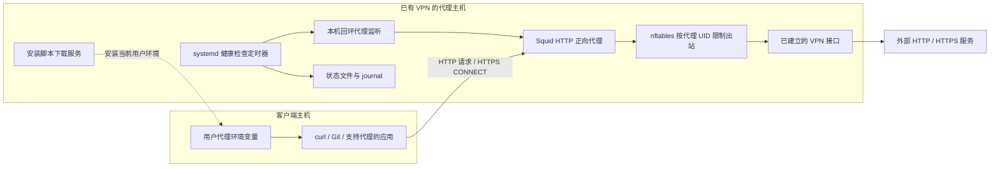

# VPN HTTP 代理

本项目将一台已有 VPN 连接的 Linux 主机作为 HTTP 正向代理出口，让其他机器上的 curl、Git 等应用通过这台主机访问外网。项目负责代理部署、客户端环境配置、VPN 出口限制和健康检查；VPN 连接由主机原有的 VPN 客户端维护。

客户端没有固定 IP 限制，访问权限由服务端配置的来源网段决定。支持 Linux Bash 和 Windows PowerShell 客户端，每个用户独立安装自己的代理环境。

## 架构



当前仓库配置的监听如下，均由 `config.json` 生成或读取：

| 用途 | 当前地址 | 访问方式 |
| --- | --- | --- |
| 应用代理 | `172.16.14.233:7897` | 通过来源 CIDR 白名单控制 |
| 本机健康检查 | `127.0.0.1:17897` | 仅回环监听 |
| Linux 安装脚本 | `172.16.14.233:8089/install.sh` | 与代理共用来源网段配置 |
| Windows 安装脚本 | `172.16.14.233:8089/install.ps1` | 与 Linux 下载共用访问策略 |
| 外网出口 | `ppp0` | 依赖主机已建立的 VPN 和路由 |

这些是当前部署参数，客户端和服务端程序不校验某一台固定的客户端机器。

## 工作原理

### 应用如何使用代理

客户端安装器写入 `http_proxy`、`https_proxy` 及对应的大写变量，并清除 `all_proxy` / `ALL_PROXY`。支持这些变量的应用随后连接 Squid。

HTTP 请求由 Squid 转发。HTTPS 请求先向 Squid 发送 CONNECT，建立到目标 443 端口的 TCP 隧道，再由客户端与目标站点进行 TLS 握手。项目没有配置 TLS 解密或证书替换，因此 `https_proxy` 仍使用 `http://代理地址:端口`。

`no_proxy` 用于让指定地址绕过代理。安装器保留用户已有条目，加入本机回环地址、所选代理主机，以及配置或参数指定的条目。

此方式只影响使用该代理的应用。脚本不修改客户端默认路由，也不部署系统级流量转发或 NAT；已运行的子进程、其他用户及独立 systemd 任务不会自动继承当前用户的新环境。

### 代理访问控制与 DNS

Squid 只允许 `allowed_clients` 中的来源网段，以及本机回环健康检查。目标端口限于 80、443，CONNECT 仅允许 443；访问回环、私网、链路本地等配置列出的目标地址会被拒绝。

Squid 直接向 `dns_nameservers` 指定的 DNS 服务器查询。DNS 请求由代理进程发出，也受 VPN 出口规则约束，不通过主机的本地 DNS stub 转发。

代码关闭磁盘缓存，保留访问和运行日志。

### VPN 断线保护

Squid 以独立系统用户 `rk-vpn-proxy` 运行。[scripts/firewall.sh](scripts/firewall.sh) 创建专用 `inet rk_vpn_proxy` 表，只匹配这个用户的出站流量，依次放行：

1. 从代理监听端口返回客户端的连接回复。
2. Squid 在回环接口上的本机 UDP 进程通信。
3. 经 `vpn_interface` 指定接口发出的流量，包括 DNS。

其余出站流量被拒绝。专用规则存在时，即使 VPN 掉线后系统改用普通网卡，代理也不能借用该出口。VPN 接口及正确路由恢复后，新请求可恢复；已经断开的下载仍需客户端重试。

`rk-vpn-proxy.service` 在防火墙服务之后启动，并通过 `BindsTo` 关联该服务。防火墙加载使用单次 nftables 事务，不清空其他表；停止防火墙单元本身也不会删除已加载规则。

### 配置生成与健康检查

[configuration.py](configuration.py) 校验配置，[build-installer.py](build-installer.py) 生成独立客户端安装脚本、Squid 配置及运行参数文件。生成文件位于 `build/`。部署后的配置位于 `/etc/rk-vpn-proxy/`，下载程序及脚本副本位于 `/usr/local/lib/rk-vpn-proxy/`，下载服务从已部署配置读取访问白名单。

健康检查由 `rk-vpn-health` 用户运行，定时器开机约 45 秒后首次触发，此后约每 60 秒执行一次。它检查 VPN 接口 IPv4 地址、到第一个配置 DNS 地址的路由，并通过回环代理访问 `https://api.ipify.org`。

检查失败返回非零退出码；状态变化和出口 IP 变化写入 journal。状态文件保存在 `/var/lib/rk-vpn-proxy/status` 和 `/var/lib/rk-vpn-proxy/exit-ip`。健康检查负责探测和记录，不控制 VPN 重连。

## 优点与限制

| 优点 | 对应实现 |
| --- | --- |
| 适用于多台客户端、多个用户 | 客户端安装按当前 `HOME` 写入，权限按服务端 CIDR 控制 |
| 应用接入方便 | 使用常见 HTTP 代理环境变量，支持 HTTPS CONNECT |
| 出口限制范围明确 | nftables 只对 `rk-vpn-proxy` 用户增加出站限制 |
| VPN 中断时阻止普通网络回退 | 按实际出站接口放行，其他出口拒绝 |
| 部署参数集中管理 | 配置校验后生成代理、客户端和防火墙运行参数 |
| 可运维和验证 | systemd 服务、日志轮转、状态探测、配置备份与隔离网络测试 |

实际使用中需要考虑以下限制：

- 支持范围是 HTTP/HTTPS 应用代理，不提供全系统隧道、UDP 代理或任意端口的 TCP 转发；部分应用需要另行设置代理。
- 代理主机和 VPN 是共同依赖。代码不建立 VPN、不实现 VPN 自动重连，也没有多代理节点切换功能。
- 安装包含公网连通性检查；公网暂时不可用时可能返回失败，此时部分服务可能已经创建或启动。
- 访问控制基于来源 IP/CIDR，没有账号密码认证；安装脚本下载服务使用 HTTP，没有配置 HTTPS、签名校验或下载令牌。HTTP 下载链路不能校验脚本真实性，可信传输可使用下文 SSH 方式。
- 防火墙服务为一次性加载。外部程序清空专用规则后，需要重新加载规则；健康检查不检查 nftables 规则完整性。
- 服务端监听、DNS 配置和健康路由探测按 IPv4 实现，没有完整的 IPv6 部署流程。
- 健康检查依赖公网探测服务，只记录状态和 IP 变化，不发送外部告警。项目未提供带宽限额、连接配额或性能保证。

## 部署服务端

适用于提供 apt、systemd 和 nftables 的 Ubuntu 环境。主机需已建立 VPN，具备到客户端的回程路由，并能经 VPN 访问外网。运行脚本前应具备 Bash、Python 3、curl、iproute2 和 sudo/root 权限；隔离网络测试还使用 util-linux 的命名空间工具。

项目可放在任意目录。先编辑 [config.json](config.json)：

| 字段 | 含义 |
| --- | --- |
| `listen_host` | 本机 IPv4 监听地址 |
| `advertise_host` | 客户端连接的代理 IPv4 地址或 DNS 名称 |
| `proxy_port` | HTTP 代理端口 |
| `health_port` | 回环健康检查端口 |
| `installer_port` | 安装脚本下载端口 |
| `vpn_interface` | 允许代理使用的 VPN 出站接口 |
| `allowed_clients` | 允许访问代理及下载服务的来源 CIDR 列表 |
| `dns_nameservers` | Squid 使用的 IPv4 DNS 服务器 |
| `test_url` | 客户端安装时验证的 HTTPS 地址 |
| `no_proxy` | 合并进客户端 `no_proxy` 的默认条目 |

当前默认白名单只包含已知编译服务器 `10.10.10.206/32` 和 Windows 客户端 `172.16.14.66/32`，并为这些客户端保留了已知的内网 `no_proxy` 主机。新增客户机或新内网服务时需显式修改 `allowed_clients` 与 `no_proxy`。不要直接放开整个 RFC1918 私网。

```bash
cd /path/to/vpn-proxy
sudo bash install.sh
```

安装器检查发行版 `squid.service` 是否正在运行；发现已有服务时退出，由管理员先处理迁移。Squid 和 nftables 分别检查并按需安装。创建代理、健康检查和下载服务的独立系统账户后，安装器备份配置、校验 Squid 配置、加载防火墙、启动代理、下载服务及监控，并执行连通性检查。启用 UFW 时，为配置中的来源网段增加代理和下载端口规则。

修改项目配置或程序后重新部署，安装器会更新运行副本和相关服务：

```bash
sudo bash install.sh
```

也支持 `sudo bash install.sh /path/to/config.json`。应修改配置源文件后重新部署，不直接修改 `build/` 下的生成文件。下载服务以 `rk-vpn-installer` 用户运行，程序路径固定在 `/usr/local/lib/rk-vpn-proxy/`，不依赖部署者的用户名、家目录或源码位置。

## 配置客户端

### Linux / Bash

推荐先使用 SSH 校验代理服务器主机密钥并获取脚本，避免直接执行明文 HTTP 响应：

```bash
source <(ssh -o StrictHostKeyChecking=ask proxy_user@172.16.14.233 'cat /usr/local/lib/rk-vpn-proxy/build/client-install.sh')
```

若只能访问 HTTP 下载服务，应先独立下载并核对脚本内容或可信 SHA-256 哈希，而非直接执行。

作为兼容保留的 HTTP 方式（**不推荐用于正式部署**），在需要代理的机器上用实际使用的用户打开 Bash，执行：

```bash
source <(curl --noproxy '*' -fsSL http://172.16.14.233:8089/install.sh)
```

该命令中的主机和端口应与实际下载服务一致。安装器先验证代理的 CONNECT 隧道和目标 HTTPS 响应，成功后备份该用户配置，写入环境文件并加载，最后执行 Google HEAD 测试。连接超时为 20 秒，单次请求最长 45 秒，临时错误最多重试 2 次。

需要覆盖代理地址时，传入第一个参数：

```bash
source <(curl --noproxy '*' -fsSL http://172.16.14.233:8089/install.sh) http://proxy.example.internal:7897
```

也支持 `RK_VPN_PROXY_URL`、`RK_VPN_TEST_URL`、`RK_VPN_NO_PROXY`。例如指定额外的内网绕过地址：

```bash
RK_VPN_NO_PROXY=git.internal,redmine.internal source <(curl --noproxy '*' -fsSL http://172.16.14.233:8089/install.sh)
```

HTTPS 代理探测要求 CONNECT 成功且目标返回 2xx 或 3xx。探测失败不会覆盖持久配置。环境文件为 `~/.config/rk-vpn-proxy/env.sh`，备份位于同目录的 `backups/`。安装器在 `.bashrc`、`.profile` 和已存在的优先登录入口中添加加载块，重复执行不会重复添加。

使用 `source` 可让当前终端生效；`curl ... | bash` 只在安装子进程及后续新终端生效。已有终端也可手动加载：

```bash
source ~/.config/rk-vpn-proxy/env.sh
curl -I https://www.google.com
```

不同应用对 `no_proxy` 中 CIDR 的支持不同，内网服务可按具体域名/IP 配置。Git、Java、APT 等应用若另有显式代理配置，应按该应用的实际配置方式处理。

如果客户端可以登录代理主机，也可通过 SSH 获取同一个安装脚本。核对 SSH 主机密钥，按实际账户和项目路径执行：

```bash
source <(ssh -o StrictHostKeyChecking=ask proxy_user@172.16.14.233 'cat /usr/local/lib/rk-vpn-proxy/build/client-install.sh')
```

### Windows / PowerShell

Windows 直接使用同一台 Ubuntu 主机的 HTTP 代理，无需在 Windows 安装 Squid 或公司 VPN 客户端。客户端需要能连接代理端口，并在来源网段白名单内。建议通过受信任的 SSH/SCP 等渠道获取安装脚本；下文保留的 HTTP 下载命令存在内容被篡改风险。

脚本使用 Windows PowerShell 5.1 语法，也可在 PowerShell 7 执行；需要系统提供 `curl.exe`。普通用户权限即可配置当前用户。

如果当前提示符是 `C:\Users\hcq>`，先执行 `powershell -NoProfile`，进入提示符以 `PS` 开头的 PowerShell。然后执行下面两行，包含终端环境及 Windows 用户代理（供遵循系统代理的浏览器/应用使用）：

```powershell
$proxyScript = curl.exe --noproxy "*" -fsSL http://172.16.14.233:8089/install.ps1
if ($LASTEXITCODE -ne 0) { throw "Installer download failed" }; & ([scriptblock]::Create(($proxyScript -join "`n"))) -SystemProxy
```

只需要 curl/Git 等终端工具时去掉 `-SystemProxy`。可以通过 `-ProxyUrl`、`-TestUrl`、`-NoProxy` 覆盖默认参数，也支持与 Bash 一致的 `RK_VPN_*` 环境变量。

安装流程先通过显式代理验证 CONNECT、TLS 及目标的 2xx/3xx 响应。成功后将 `http_proxy`、`https_proxy`、`no_proxy` 写入当前进程及当前用户环境，清除当前用户的 `all_proxy`，最后自动执行 `curl.exe -I` 测试。

Windows 环境变量名不区分大小写。当前 PowerShell 会立即生效；持久配置供新启动的应用继承，已运行的终端、IDE 等可能需要完全退出后重开。Windows PowerShell 5.1 中的 `curl` 可能是命令别名，文档统一使用 `curl.exe`。

`-SystemProxy` 额外配置 HKCU 的 Windows 用户代理，保存并移除当前 PAC URL，通知 WinINet 刷新。它不配置计算机级 WinHTTP 代理，也不转发全系统 TCP/UDP。Windows 绕过列表保留原条目并合并具体地址，`no_proxy` 中的 CIDR 不自动转换成 Windows 绕过规则。

若 Clash Verge 等程序正在接管 Windows 系统代理，应先停止其接管，避免再次覆盖本项目设置。浏览器有独立代理配置或受到策略管理时，需按该应用实际设置处理。

首次修改前的环境变量及所需的 Windows 用户代理设置备份到 `%LOCALAPPDATA%\rk-vpn-proxy\backup.json`。重复安装保留原备份；恢复时执行：

```powershell
$proxyScript = curl.exe --noproxy "*" -fsSL http://172.16.14.233:8089/install.ps1
if ($LASTEXITCODE -ne 0) { throw "Installer download failed" }; & ([scriptblock]::Create(($proxyScript -join "`n"))) -Uninstall
```

恢复后备份归档到同目录的 `restored-*.json`。HTTP 获取代码的信任边界与 Linux 安装方式相同，也可通过 SSH 读取 `/usr/local/lib/rk-vpn-proxy/build/client-install.ps1` 后执行。

接口连通性可以先独立测试：

```powershell
Test-NetConnection 172.16.14.233 -Port 7897
curl.exe --proxy http://172.16.14.233:7897 -I https://www.google.com
```

原生 Windows 的注册表、变量持久化与恢复测试位于 `tests/test-windows.ps1`；CI 分别用 Windows PowerShell 5.1 和 PowerShell 7 执行。本地 Linux 上的 PowerShell 检查仅验证脚本语法，不能替代 Windows 实机验证。

参考：[Microsoft 环境变量说明](https://learn.microsoft.com/en-us/powershell/module/microsoft.powershell.core/about/about_environment_variables)、[Windows curl 说明](https://learn.microsoft.com/windows/curl/)、[WinINet Internet 选项](https://learn.microsoft.com/en-us/windows/win32/wininet/setting-and-retrieving-internet-options)。

## 运行维护

```bash
# 代理、防火墙和监控定时器
systemctl status rk-vpn-proxy.service rk-vpn-proxy-firewall.service rk-vpn-proxy-health.timer

# 健康检查结果和日志
systemctl status rk-vpn-proxy-health.service
systemctl show rk-vpn-proxy-health.service -p Result -p ExecMainStatus
journalctl -u rk-vpn-proxy-health.service -n 30 --no-pager

# 安装脚本下载服务
systemctl status rk-vpn-proxy-installer.service

# 代理访问日志及出站规则
sudo tail -f /var/log/rk-vpn-proxy/access.log
sudo nft list table inet rk_vpn_proxy
```

健康检查是 oneshot 服务，成功执行完毕后显示 inactive 属正常情况，可结合 `Result`、`ExecMainStatus` 和 journal 判断最近执行结果。

代理日志位于 `/var/log/rk-vpn-proxy/`，每天轮转并保留 7 份。发行版的默认 Squid 单元在安装 Squid 包时被屏蔽，专用代理由 `rk-vpn-proxy.service` 管理。

需要重新加载出站规则及代理时：

```bash
sudo systemctl restart rk-vpn-proxy-firewall.service rk-vpn-proxy.service
```

### 验证

```bash
python3 -m unittest discover -s tests -v
bash check-client.sh
sudo bash tests/test-killswitch.sh
```

`check-client.sh` 可传入代理 URL，分别检查 Google、Android 下载/源码站和 GitHub 的 CONNECT、TLS 验证和 HTTP 响应，并汇总退出状态。目标网站返回 400、403 等有效 HTTP 响应不直接视为代理失败；安装器的单个测试 URL 则要求 2xx/3xx。

`tests/test-killswitch.sh` 在独立网络命名空间模拟 VPN 正常、掉线后普通网卡回退、VPN 恢复，验证代理用户的阻断和恢复，以及其他用户的网络连接。不操作真实 VPN 接口。

GitHub Actions 检查 Bash/Python 语法、运行回归测试，并检查生成文件与配置模板的一致性。

### 停用与回滚

```bash
sudo bash rollback.sh
```

回滚脚本先停用下载服务、代理及健康检查，再删除专用 nftables 表，保留配置和日志。它不卸载软件包，也不自动恢复客户端启动文件。

客户端可恢复备份，或删除启动文件中的 `rk-vpn-proxy environment` 加载块，并在当前终端执行：

```bash
unset http_proxy https_proxy HTTP_PROXY HTTPS_PROXY all_proxy ALL_PROXY
```

## 目录与维护职责

```text
vpn-proxy/
├── README.md
├── config.json                  # 部署参数
├── install.sh / rollback.sh     # 服务端部署与停用
├── check-client.sh              # 连通性诊断入口
├── configuration.py             # 共享配置校验
├── build-installer.py           # 生成部署文件
├── serve-installer.py           # 安装脚本下载服务
├── templates/                   # Bash / PowerShell 安装器、Squid 配置模板
├── scripts/                     # 防火墙与健康检查脚本
├── systemd/                     # 4 个服务单元和 1 个定时器
├── tests/                       # Python 回归测试及隔离网络测试
├── .github/workflows/           # CI
└── build/                       # 自动生成，不纳入版本控制
```

拆分按职责和运行边界进行：

- `configuration.py` 同时被生成器、下载服务及诊断工具使用，保留为共享模块。
- 客户端安装流程与环境配置放在一个模板中，便于维护完整的安装行为。
- 防火墙、代理、健康检查和下载服务有独立的账户、依赖和启停方式，systemd 单元分别维护；定时器只负责调度。
- `build/` 中的 `client-install.sh`、`client-install.ps1`、`squid.conf` 和 `runtime.env` 都是生成物，可以删除后重新运行 `python3 build-installer.py` 生成。已部署服务使用系统目录中的副本，不依赖源码下的生成目录。
- 运行日志、安装包、Python 缓存和人工验证记录不属于源码；运行日志由系统日志目录管理，历史审核材料可在项目外归档。
